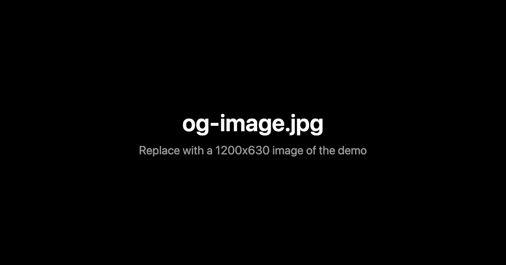

_How to use this template:_

- Styles for the demo go in css/base.css
- Fill in the title, description, canonical URL and social preview (Open Graph) tags in index.html, using the same title and description everywhere
- Replace og-image.jpg with a 1200x630 image of the demo (in a Vite project, put it in public/)
- Commit your package-lock.json so the demo keeps installing the same library versions
- Leave the analytics and sponsor scripts commented out, we add them on the live server
- Add build instructions and credits to the README.md under "Installation"
- For writing the tutorial, take a look at https://github.com/codrops/CodropsTemplate/wiki/Writing-the-article
- Delete this 'how to' intro in the final version. We'll fill in the details.

---

# Title of the demo

_A description of the demo goes here._



[Article on Codrops](https://tympanus.net/codrops/?p=)

[Demo](https://tympanus.net/Tutorials/.../)

## Installation

Run this demo on a [local server](https://developer.mozilla.org/en-US/docs/Learn/Common_questions/Tools_and_setup/set_up_a_local_testing_server).

or

```bash
npm install
npm run dev
```

## Credits

- Add credits here. Inspiration, tools used etc.

## Misc

Follow _Your Name_: [X](), [LinkedIn](), [Instagram](), [GitHub]()

Follow Codrops: [X](https://x.com/codrops), [LinkedIn](https://www.linkedin.com/company/codrops/), [Instagram](https://www.instagram.com/codropsss/), [Facebook](https://www.facebook.com/codrops), [GitHub](https://github.com/codrops)

## License

[MIT](LICENSE)
